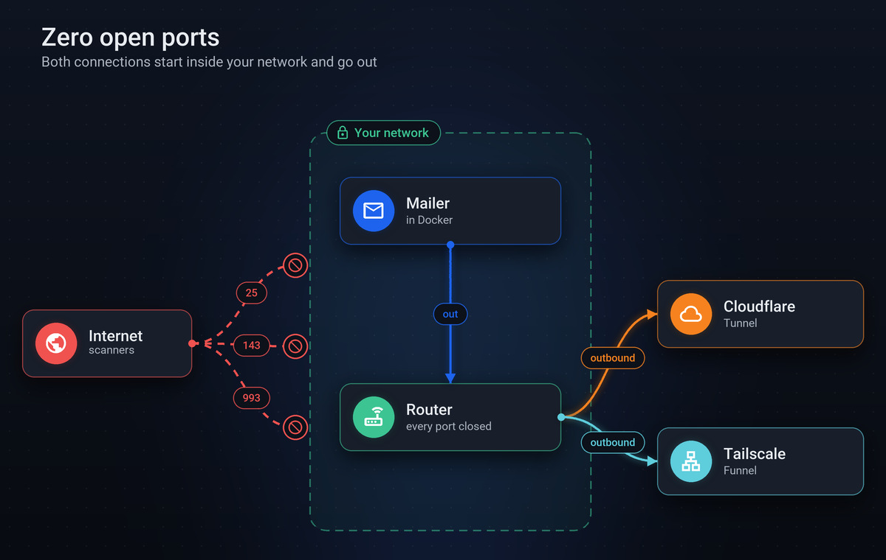
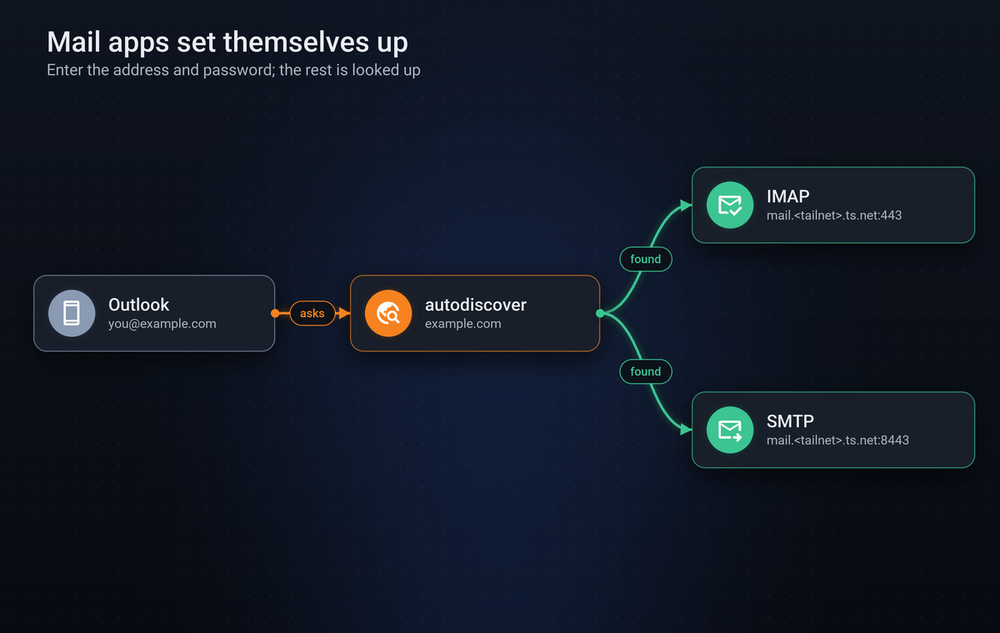
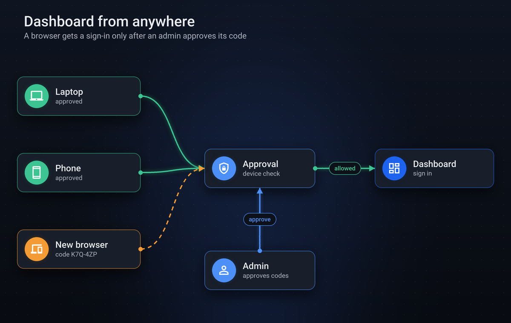

# Mailer

Self-hosted mail, zero ports.

<a href="docs/how-it-works.md"></a>

<table>
  <tr>
    <td width="50%"><a href="docs/how-it-works.md#what-setup-does"></a></td>
    <td width="50%"><a href="docs/configuration.md#ports"></a></td>
  </tr>
  <tr>
    <td width="50%"><a href="docs/how-it-works.md#what-setup-does"></a></td>
    <td width="50%"><a href="docs/configuration.md#dashboard-access"></a></td>
  </tr>
</table>

## Requirements

- Docker with Compose v2 ([Docker Desktop](https://docs.docker.com/get-docker/)
  on Windows and macOS)
- A [Cloudflare](https://dash.cloudflare.com/) account with your domains, on the
  Workers Paid plan for sending
- A [Tailscale](https://tailscale.com/) account

## Install

Linux and macOS:

```sh
curl -fsSL https://raw.githubusercontent.com/KrisPowers/mailer/main/scripts/install.sh | sh
```

Windows (PowerShell):

```powershell
irm https://raw.githubusercontent.com/KrisPowers/mailer/main/scripts/install.ps1 | iex
```

Run it again to update. From a checkout instead:

```sh
git clone https://github.com/KrisPowers/mailer.git
cd mailer
docker compose up -d --build
```

## Get started

Open <http://localhost:8080> on the computer running Mailer:

1. **Setup:** make the admin account and name the server on your tailnet.
2. **Connect Cloudflare** and approve in the tab that opens.
3. **Tailscale, Enable**, and follow the links it shows.
4. **New account** (top right) lists the settings for your mail app.

Every guide is in the dashboard under **Docs**.

## Contributing

Issues and pull requests are welcome; see [CONTRIBUTING](.github/CONTRIBUTING.md).
Report security problems privately as described in [SECURITY](.github/SECURITY.md).

## License

[MIT](LICENSE)
